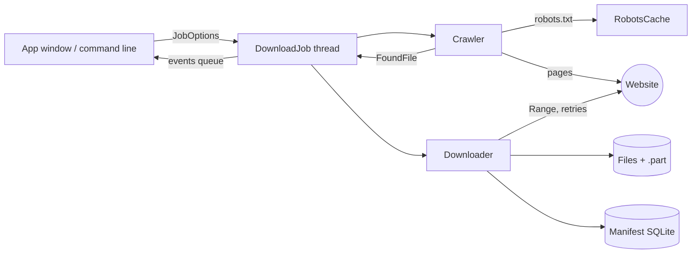

# How it works

## Crawling

The crawler does a breadth-first walk from the start page. For each page it:

1. checks the page is on the start site and allowed by `robots.txt`
2. waits the polite delay (or the site's `Crawl-delay`, if longer)
3. downloads the HTML and reads links from `a`, `img`, `video`, `audio`,
   `source`, `track`, `embed`, `object`, `link` and `srcset`, honouring `<base>`
4. a link with a known file extension is a **file**: it is checked against the
   filters and recorded once; any other same-site link is a **page** and is
   queued if the depth limit allows

With `--sitemap`, pages listed in `/sitemap.xml` are added at depth 1, which
finds pages that nothing links to.

## Downloading

Each file is streamed to `name.ext.part` and only renamed to `name.ext` when it
is complete, so an unfinished file never looks finished.

| Situation | What happens |
|---|---|
| a `.part` file exists | resume with `Range: bytes=N-`; if the server ignores it (200), start again |
| server answers 416 | the `.part` file is already complete; finish it |
| network error or 5xx | retry, waiting 1 s, 2 s, 4 s… |
| 4xx | fail straight away, no retry |
| same name, same size already saved | skip ("already downloaded") |
| same name, different file | save as `name (1).ext` |
| same SHA-256 as an earlier file | delete the new copy, record a "duplicate" |
| over the size limit | skip before downloading the body |

## Keeping the window responsive

Crawling and downloading run on a `DownloadJob` thread. The thread never
touches the window; it puts `(kind, payload)` events on a queue: `status`,
`page`, `found`, `progress`, `result` and finally `done`. The window reads the
queue every 100 ms and updates the table. Pause blocks the job inside
`should_stop()`, which the crawler and every download check between steps.

## Speed limit

All download threads share one token bucket. Each chunk takes tokens equal to
its size; when the bucket is empty the thread sleeps just long enough for the
average speed to match the limit.
