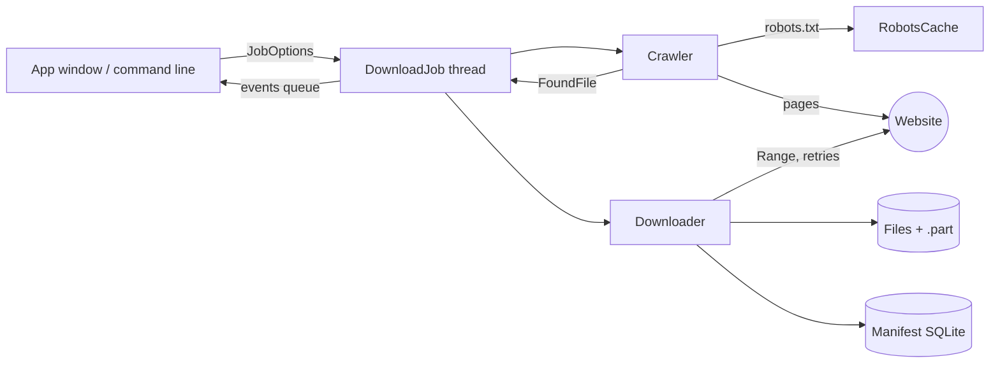

# How it works

## Crawling

The crawler does a breadth-first walk from the start page. For each page it:

1. checks the page is on the start site and allowed by `robots.txt`
2. waits the polite delay (or the site's `Crawl-delay`, if longer)
3. downloads the HTML and reads links from `a`, `img`, `video`, `audio`,
   `source`, `track`, `embed`, `object`, `link` and `srcset`, honouring `<base>`
4. a link with a known file extension is a **file**: it is checked against the
   filters and recorded once; any other same-site link is a **page** and is
   queued if the depth limit allows

With `--sitemap`, pages listed in `/sitemap.xml` are added at depth 1, which
finds pages that nothing links to.
